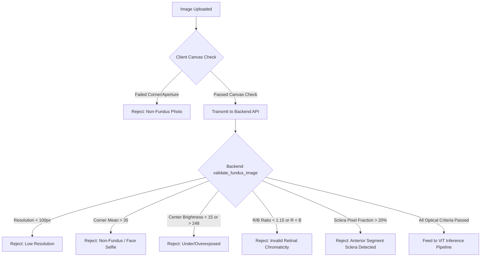
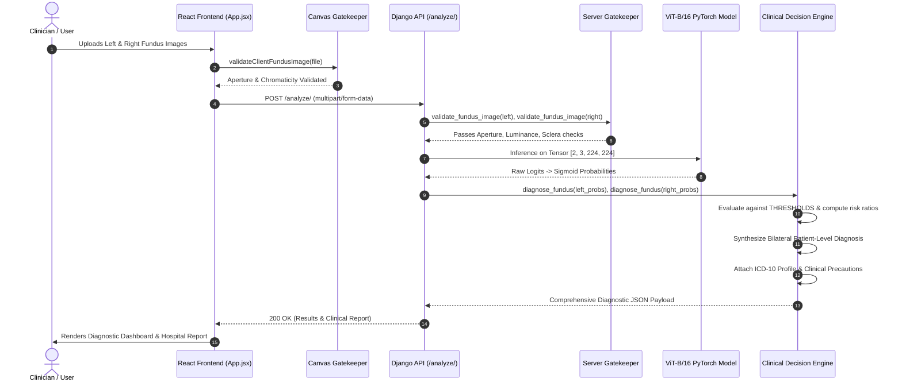
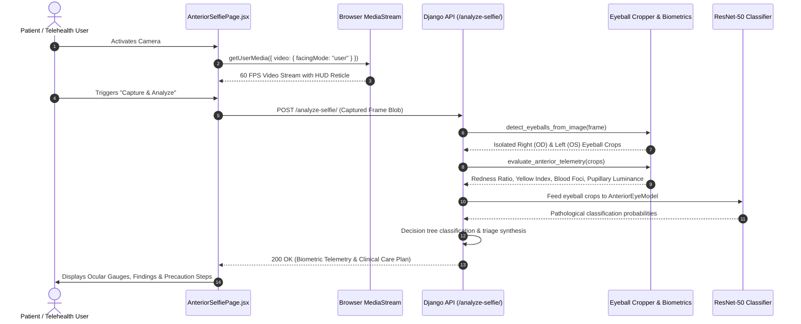
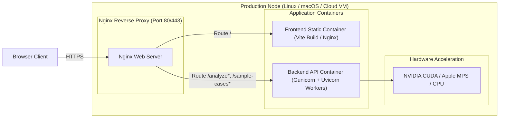

# System Architecture Document (SAD)

## Project: Vision AI — Intelligent Retinal & Anterior Ophthalmic Screening Platform
**Document Version:** 1.0.0  
**Status:** Approved / Active Architecture Specification  
**Classification:** Clinical Decision Support Software Architecture (SaMD Concept)  
**Repository:** `retinal-ai-vit` (`Nchethan12/Vision_AI`)  

---

## 1. Architectural Overview & Design Philosophy

Vision AI is designed as a **dual-modality, micro-service-ready ophthalmic screening architecture**. It integrates high-throughput deep learning (Vision Transformers and Deep Residual Networks) with real-time computer vision biometrics, client-side optical gatekeeping, and WebGL-accelerated 3D anatomical rendering.

```mermaid
graph TB
    subgraph Client["Presentation Tier (Frontend - React 19 + Vite)"]
        UI[Medical Triage Dashboard]
        ThreeJS[Three.js Holographic Eye & Particle Background]
        CameraEngine[WebRTC Camera & Ocular Reticle]
        ClientValidator[Canvas Optical Gatekeeper]
        ReportEngine[Hospital Report & Print Engine]
    end

    subgraph Gateway["API Gateway & Service Layer (Django 6)"]
        Router[urls.py Dispatcher]
        FundusFilter[Optical & Chromaticity Gatekeeper]
        FaceCropper[Bilateral Eyeball Localization Engine]
        TelemetryEngine[CV Biometric Telemetry Pipeline]
        Calibrator[Clinical Threshold & Multi-Label Decision Engine]
        KnowledgeRegistry[ICD-10 & Clinical Disease Knowledge Base]
    end

    subgraph Inference["Deep Learning Inference Subsystem (PyTorch)"]
        ViTModel[Vision Transformer ViT-B/16 (ODIR-5K Retinal Head)]
        ResNetModel[ResNet-50 (14-Class Anterior Head)]
    end

    ClientValidator -->|Sanitized Fundus Upload| Router
    CameraEngine -->|Live WebRTC Stream / Selfie| Router

    Router -->|POST /analyze/| FundusFilter
    FundusFilter -->|Validated 224x224 Fundus| ViTModel
    ViTModel -->|Logits -> Sigmoid Probs| Calibrator

    Router -->|POST /analyze-selfie/| FaceCropper
    FaceCropper --> TelemetryEngine
    TelemetryEngine --> ResNetModel

    Calibrator --> KnowledgeRegistry
    KnowledgeRegistry --> Router
    Router -->|Structured Diagnostic JSON| UI
    UI --> ReportEngine
```

### 1.1 Core Architectural Principles
1. **Separation of Diagnostic Modalities:** Mode A (Posterior Pole / Retinal Fundus) and Mode B (Anterior Segment / External Eye) operate on independent inference and validation pipelines.
2. **Defensive Clinical Gatekeeping:** Strict dual-tier validation (client canvas + server PIL/NumPy) prevents out-of-distribution inputs (e.g., face selfies, non-medical photos) from reaching posterior fundus models.
3. **Calibrated Multi-Label Decision Engine:** Replaces generic $0.50$ softmax thresholds with disease-specific ROC-calibrated clinical operating cutoffs to counteract clinical class imbalance.
4. **Zero-Persistent Protected Health Information (PHI):** All uploaded ophthalmic imagery and camera frames are streamed directly into volatile system memory, evaluated, and immediately garbage-collected without persistent disk storage.
5. **Hardware-Agnostic Acceleration:** The backend dynamically arbitrates between Apple Silicon MPS (`torch.backends.mps`), NVIDIA CUDA (`torch.cuda`), and multi-threaded CPU runtimes.

---

## 2. Component Architecture & System Layers

### 2.1 Layer Breakdown

```
+-----------------------------------------------------------------------+
| 1. PRESENTATION LAYER (React 19, Vite, Three.js, Lucide-React)       |
|    - App.jsx (Root coordinator, state management, modal controllers) |
|    - AnteriorSelfiePage.jsx (WebRTC camera, targeting reticle, HUD)  |
|    - HospitalReport.jsx (Standardized clinical reports & print CSS)   |
|    - HolographicEye3D.jsx & RetinalBackground3D.jsx (WebGL Three.js) |
|    - TiltCard.jsx, CursorGlow.jsx, FeatureDetailModal.jsx (UI/UX)   |
+-----------------------------------------------------------------------+
                                  |
                           HTTP / REST JSON
                                  v
+-----------------------------------------------------------------------+
| 2. API GATEWAY & DISPATCH LAYER (Django 6 RESTful Gateway)           |
|    - api/urls.py (Endpoint routing & dispatching)                    |
|    - api/views.py (Request sanitization, error boundaries, CORS)     |
+-----------------------------------------------------------------------+
                                  |
                   In-Memory Image Stream (PIL / NumPy)
                                  v
+-----------------------------------------------------------------------+
| 3. VALIDATION & PREPROCESSING PIPELINE                                |
|    - validateClientFundusImage (Canvas 4-corner aperture check)      |
|    - validate_fundus_image (Aperture, hemoglobin chromaticity ratio)  |
|    - detect_eyeballs_from_image (Ocular zone argmin coordinate crop)  |
+-----------------------------------------------------------------------+
                                  |
                      Tensor (Batch, 3, 224, 224)
                                  v
+-----------------------------------------------------------------------+
| 4. DEEP LEARNING & COMPUTER VISION INFERENCE LAYER                    |
|    - VisionAIModel (ViT-B/16 with replaced 8-class linear head)       |
|    - AnteriorEyeModel (ResNet-50 with replaced 14-class linear head)  |
|    - evaluate_anterior_telemetry (Scleral redness, yellow, blood foci)|
+-----------------------------------------------------------------------+
                                  |
                       Raw Probability Vectors
                                  v
+-----------------------------------------------------------------------+
| 5. DIAGNOSTIC DECISION & CLINICAL CALIBRATION LAYER                   |
|    - Calibrated Operating Thresholds (Normal, DR, Glaucoma, AMD, etc)|
|    - Non-linear Risk Scaling & Normalization Formula                 |
|    - Bilateral Synthesis (OS vs. OD max-risk aggregation)            |
|    - CLINICAL_DISEASE_PROFILES & ICD-10 Registry                      |
+-----------------------------------------------------------------------+
```

---

## 3. Deep Learning & Computer Vision Specifications

### 3.1 Mode A: Vision Transformer (ViT-B/16) Retinal Model

#### Architecture
The retinal classifier employs a **Vision Transformer (ViT-B/16)** pre-trained on ImageNet-1K (`ViT_B_16_Weights.DEFAULT`) and fine-tuned on the multi-label ODIR-5K fundus dataset.

```
Input Image [3, 224, 224]
        |
Patch Projection (Patch Size = 16x16) -> (224/16)^2 = 196 Patches
        |
Linear Projection to Hidden Dimension D = 768
        |
Prepend Learnable [CLS] Token -> Tensor Shape: [1, 197, 768]
        |
Add 1D Learnable Positional Embeddings
        |
12x Transformer Encoder Blocks:
   +--> LayerNorm -> Multi-Head Self-Attention (12 Heads) -> Residual Add
   +--> LayerNorm -> MLP Block (Linear 768 -> 3072 -> GeLU -> 768) -> Residual Add
        |
Extract [CLS] Token Representation (Dimension: 768)
        |
LayerNorm -> Linear Classifier Head: nn.Linear(768, 8)
        |
Output Logits [1, 8] -> Sigmoid Activation -> Probabilities [0.0 - 1.0]
```

#### Multi-Label Classification
Fundus diseases frequently co-occur (e.g., a patient can present with both Diabetic Retinopathy and Cataract simultaneously). The output layer uses an **independent Sigmoid activation** per class (rather than Softmax), trained using Binary Cross-Entropy with Logits:
$$\mathcal{L}_{\text{BCE}} = -\frac{1}{C}\sum_{c=1}^{C} \left[ y_c \log \sigma(z_c) + (1 - y_c) \log(1 - \sigma(z_c)) \right]$$
where $C = 8$, $y_c \in \{0, 1\}$ denotes disease presence, and $z_c$ is the logit for class $c$.

#### Disease Taxonomy & Class Indices
1. `0: Normal (N)`
2. `1: Diabetic Retinopathy (D)`
3. `2: Glaucoma (G)`
4. `3: Cataract (C)`
5. `4: AMD (A)`
6. `5: Hypertension (H)`
7. `6: Myopia (M)`
8. `7: Other Diseases / Abnormalities (O)`

---

### 3.2 Mode B: Anterior Segment ResNet-50 & CV Telemetry Pipeline

#### Architecture
Mode B uses a dual-engine approach combining deep convolutional representations with handcrafted computer vision biometrics:

1. **Deep Network:** `AnteriorEyeModel` based on `ResNet-50` (`ResNet50_Weights.DEFAULT`) with replaced fully connected layer:
   ```python
   self.backbone.fc = nn.Linear(in_features=2048, out_features=14)
   ```
2. **14 Anterior Pathological Classes:**
   - Corneal/Conjunctival Tumor, Pigmented Nevus, Pinguecula, Conjunctival Injection, Corneal Dystrophy, Subconjunctival Hemorrhage, Keratitis, Cataract, Pterygium, Conjunctival Cyst, Intraocular Lens (IOL), Corneal Scarring, Lens Dislocation, Lens Dislocation/Cataract.

#### Facial Eyeball Localization Engine (`detect_eyeballs_from_image`)
When a full-face selfie or dual-eye stream is received, the system extracts the individual ocular globes using luminance topology:
1. Converts the image to grayscale ($L$).
2. Restricts the vertical search space to the ocular band: $Y \in [0.18 \cdot H, 0.65 \cdot H]$.
3. Partitions the band horizontally into Right Eye Zone ($X \in [0.06 \cdot W, 0.475 \cdot W]$) and Left Eye Zone ($X \in [0.525 \cdot W, 0.94 \cdot W]$).
4. Identifies the darkest pixel cluster (pupillary core) via 2D coordinate argmin:
   $$(y_{\text{pupil}}, x_{\text{pupil}}) = \arg\min_{(y, x)} I_{\text{ocular}}(y, x)$$
5. Extracts normalized square bounding boxes ($W_{\text{box}} = 0.32 \cdot W, H_{\text{box}} = 0.38 \cdot H$) centered on each coordinate, returning isolated OD and OS image crops.

#### Biometric Telemetry Calculations (`evaluate_anterior_telemetry`)
Extracted crops are converted to floating-point RGB matrices and evaluated across segmented scleral regions ($110 \le \text{Brightness} \le 248$):

| Metric | Mathematical Definition | Clinical Condition Detected | Threshold |
| :--- | :--- | :--- | :---: |
| **Scleral Redness Ratio** | $\text{Redness} = \frac{\bar{R}_{\text{sclera}}}{\bar{G}_{\text{sclera}} + \bar{B}_{\text{sclera}} + 10^{-4}}$ | Conjunctivitis / Pink Eye | $> 0.72$ |
| **Focal Capillary Blood Density** | $\text{Density} = \frac{1}{N}\sum \mathbb{I}\left(R > 165 \land G < 95 \land B < 95\right)$ | Subconjunctival Hemorrhage | $> 3.5\%$ |
| **Bilirubin Yellow Index** | $\text{Index} = \frac{1}{N}\sum \left[\left(0.5 R + 0.5 G\right) - B\right]$ | Scleral Icterus / Jaundice | $> 38.0$ |
| **Pupillary Luminance** | $\bar{L}_{\text{pupil}} = \text{mean}(I[0.35H:0.65H, 0.35W:0.65W])$ | Leukocoria / Mature Cataract | $> 165.0$ |
| **Eyelid Margin Erythema** | $\text{Erythema} = \frac{\bar{R}_{\text{eyelid}}}{\bar{G}_{\text{eyelid}} + \bar{B}_{\text{eyelid}} + 10^{-4}}$ | Stye (Hordeolum / Chalazion) | $> 0.75$ |

---

## 4. Optical Quality & Image Validation Pipeline

To protect clinical safety and prevent adversarial or accidental non-fundus inputs, Vision AI implements a **dual-tier optical gatekeeper**.



### 4.1 Server-Side Gatekeeper Algorithm (`validate_fundus_image`)
1. **Resolution Assertion:** Verifies $H \ge 100\text{ px}$ and $W \ge 100\text{ px}$.
2. **Optical Barrel Aperture Check:** Medical fundus cameras photograph through a round circular aperture lens, leaving the 4 image corners unilluminated. The system samples $5\%$ corner patches:
   $$\bar{C}_{\text{corners}} = \frac{1}{4}\left(\bar{I}_{\text{TL}} + \bar{I}_{\text{TR}} + \bar{I}_{\text{BL}} + \bar{I}_{\text{BR}}\right)$$
   If $\bar{C}_{\text{corners}} > 35.0$, the image is rejected as an external photograph or screenshot.
3. **Luminance Range Check:** Computes central $50\%$ crop mean intensity:
   $$\bar{L}_{\text{center}} = \frac{1}{3}\left(\bar{R} + \bar{G} + \bar{B}\right)$$
   Rejects if $\bar{L}_{\text{center}} < 15.0$ (underexposed/dark flash failure) or $\bar{L}_{\text{center}} > 248.0$ (overexposed/whiteout).
4. **Choroidal Hemoglobin Chromatic Profile:** Choroidal blood volume ensures strong red dominance over blue and green wavelengths:
   $$\text{Ratio}_{\text{RB}} = \frac{\bar{R}_{\text{center}}}{\bar{B}_{\text{center}} + 10^{-4}} \ge 1.15 \quad \text{and} \quad \bar{R}_{\text{center}} \ge 0.90 \cdot \bar{G}_{\text{center}}$$
5. **Sclera & Skin Exclusion Check:** Computes color saturation:
   $$S = \frac{\max(R, G, B) - \min(R, G, B)}{\max(R, G, B) + 10^{-5}}$$
   Pixels where $\bar{L} > 130$ and $S < 0.10$ indicate white sclera or external skin. If this fraction exceeds $20\%$, the upload is rejected.

---

## 5. Diagnostic Decision Logic & Risk Scoring Engine

### 5.1 Calibrated Operating Thresholds
Standard softmax thresholds ($0.50$) fail in clinical screening due to class imbalance in datasets like ODIR-5K (Normal: $45\%$, Glaucoma: $4.9\%$, Hypertension: $2.4\%$). Vision AI applies empirical operating thresholds calibrated against validation ROC curves:

```python
THRESHOLDS = {
    "Normal": 0.55,
    "Diabetic Retinopathy": 0.18,
    "Glaucoma": 0.045,
    "Cataract": 0.50,
    "AMD": 0.08,
    "Hypertension": 0.06,
    "Myopia": 0.15,
    "Other": 0.08,
}
```

### 5.2 Risk Ratio & Non-Linear Score Normalization
For every disease category $c$, the raw model probability $p_c$ is converted to a clinical **Risk Ratio**:
$$r_c = \frac{p_c}{\tau_c}$$
where $\tau_c$ is the disease threshold. The system computes a calibrated $0-100\%$ risk score $S_c$ using a three-stage continuous response mapping:

$$S_c(r_c) = \begin{cases}
45.0 \cdot r_c & \text{if } r_c < 1.0 \quad \text{(Sub-threshold / Low Risk)} \\
50.0 + 30.0 \cdot (r_c - 1.0) & \text{if } 1.0 \le r_c < 2.0 \quad \text{(Elevated Risk)} \\
\min\left(99.5, 80.0 + 6.5 \cdot (r_c - 2.0)\right) & \text{if } r_c \ge 2.0 \quad \text{(High Risk / Acute Finding)}
\end{cases}$$

### 5.3 Bilateral Synthesis Algorithm
When both Left Eye (OS) and Right Eye (OD) scans are provided:
1. Evaluates raw probabilities $p_{\text{OS}}(c)$ and $p_{\text{OD}}(c)$.
2. Derives patient-level probability:
   $$p_{\text{Patient}}(c) = \max\left(p_{\text{OS}}(c), p_{\text{OD}}(c)\right)$$
3. Produces bilateral clinical verdict:
   - If both eyes detect the same disease: `Bilateral [Disease] Detected`.
   - If each eye exhibits different pathology: `Bilateral Pathology: OS ([DiseaseA]), OD ([DiseaseB])`.
   - If only one eye exhibits pathology: `[Affected Eye]: [Disease] Detected | [Healthy Eye]: Normal`.
   - If neither eye exceeds threshold: `Bilateral Normal Retinal Fundus (Healthy)`.

---

## 6. Frontend Subsystem & 3D WebGL Architecture

### 6.1 Component Hierarchy

```
App.jsx (Root State, Tab Switching, API Orchestration)
  │
  ├── RetinalBackground3D.jsx (Persistent WebGL 3D Particle Mesh Background)
  ├── CursorGlow.jsx (Mouse spotlight ambient lighting)
  │
  ├── Navbar (Navigation, Mode Switch: Retinal vs. Selfie, Demo Preload)
  │
  ├── Main Retinal Screening View (activeMode === "retinal")
  │     ├── Hero Section (HolographicEye3D.jsx WebGL Anatomy)
  │     ├── Upload Zone (Drag-and-Drop, Dual Eye Selector, Client Gatekeeper)
  │     ├── Results Dashboard (Conditional on Analysis Output)
  │     │     ├── Verdict Card (Severity Badge, Confidence Gauge, Action Buttons)
  │     │     ├── Bilateral Comparison Grid (OS vs. OD breakdown)
  │     │     ├── Quantitative Risk Bar Graph (Calibrated Disease Spectrum)
  │     │     └── Embedded HospitalReport.jsx
  │     └── Reference Test Cases (ODIR-5K sample case selector)
  │
  ├── Anterior Selfie View (activeMode === "selfie" -> AnteriorSelfiePage.jsx)
  │     ├── WebRTC Stream Engine & Target Reticle HUD
  │     ├── Dual-Eyeball Extractor Preview (OD & OS visual crops)
  │     ├── Biometric Telemetry Gauges (Redness, Jaundice, Capillary Density)
  │     ├── Preset Anterior Case Gallery
  │     └── Embedded HospitalReport.jsx
  │
  ├── FeatureDetailModal.jsx (Disease educational deep-dive overlay)
  └── Standalone Report Modal (Fullscreen printable medical record)
```

### 6.2 Three.js 3D Holographic Eyeball Anatomy (`HolographicEye3D.jsx`)
The 3D eye model is dynamically generated in client WebGL without external `.gltf` asset dependencies:
- **Sclera Geometry:** `SphereGeometry(2.2, 64, 64)` with custom glassmorphic mesh physical material (`MeshPhysicalMaterial`), subtle subsurface scattering, and procedural episcleral micro-vessel bump maps.
- **Corneal Dome:** Anterior bulging sphere segment with high specular transmission ($0.95$), low roughness ($0.05$), and refractive index ($\text{IOR} = 1.336$ matching human corneal refractive index).
- **Iris Stroma:** Radial ring geometry with multi-layered concentric procedural pigmentation and depth grooves.
- **Pupillary Aperture:** Dynamic dark circular core responding to cursor proximity simulating light accommodation.
- **Interactive Parallax:** Smooth lerp rotation responding to cursor mouse move coordinates:
  $$\theta_x = \text{lerp}\left(\theta_x, y_{\text{mouse}} \cdot 0.35, 0.05\right), \quad \theta_y = \text{lerp}\left(\theta_y, x_{\text{mouse}} \cdot 0.50, 0.05\right)$$

---

## 7. Data Flow & Sequence Diagrams

### 7.1 Sequence 1: Posterior Retinal Fundus Screening



### 7.2 Sequence 2: Anterior Selfie WebRTC Telemetry Screening



---

## 8. Directory Structure & File Map

```
retinal-ai-vit/
├── prd.md                                # Product Requirements Document
├── architecture.md                       # System Architecture Document (This File)
├── README.md                             # Repository Overview
│
├── backend/                              # Django 6 Backend Gateway & ML Pipeline
│   ├── manage.py                         # Django management script
│   ├── db.sqlite3                        # SQLite development database
│   ├── api/
│   │   ├── __init__.py
│   │   ├── settings.py                   # Django configuration, CORS, installed apps
│   │   ├── urls.py                       # REST routing (/analyze/, /analyze-selfie/, /sample-cases/)
│   │   ├── views.py                      # Core validation, CV biometrics, diagnostic logic, reports
│   │   ├── asgi.py                       # ASGI configuration
│   │   └── wsgi.py                       # WSGI configuration
│   └── ml/
│       ├── model.py                      # VisionAIModel (ViT-B/16 architecture definition)
│       ├── dataset.py                    # ODIRDataset loader & image augmentation transforms
│       ├── train.py                      # Training loop with AdamW & BCEWithLogitsLoss
│       ├── predict.py                    # Standalone inference helper
│       ├── test_dataloader.py            # Unit test for PyTorch dataset
│       ├── test_training_step.py         # Unit test for single forward/backward pass
│       ├── weights/                      # Trained ViT-B/16 model weights checkpoint
│       └── selfie/                       # Anterior Segment Subsystem
│           ├── model.py                  # AnteriorEyeModel (ResNet-50 architecture definition)
│           ├── dataset.py                # AnteriorEyeDataset loader (14 ocular surface classes)
│           ├── train.py                  # Training pipeline for anterior slit-lamp dataset
│           ├── predict.py                # Standalone anterior predictor
│           └── weights/                  # Trained ResNet-50 anterior weights
│
├── frontend/                             # React 19 + Vite Frontend SPA
│   ├── package.json                      # Dependencies: Three.js, Lucide-React, Canvas-Confetti
│   ├── vite.config.js                    # Vite bundler configuration & dev server proxy
│   ├── index.html                        # HTML5 entrypoint & Google Fonts preloads
│   └── src/
│       ├── main.jsx                      # React 19 application root bootstrap
│       ├── index.css                     # Global reset & baseline font rules
│       ├── App.jsx                       # Root coordinator, bilateral upload flow, results dashboard
│       ├── App.css                       # Design system styles, glassmorphism tokens, print CSS
│       └── components/
│           ├── AnteriorSelfiePage.jsx    # Mode B WebRTC camera, ocular HUD reticle, telemetry
│           ├── HospitalReport.jsx        # Hospital-grade clinical report, ICD-10 codes, print layout
│           ├── HolographicEye3D.jsx      # WebGL Three.js interactive 3D eyeball anatomical model
│           ├── RetinalBackground3D.jsx   # Dynamic 3D neural-retinal particle background
│           ├── FeatureDetailModal.jsx    # Educational disease deep-dive modal
│           ├── TiltCard.jsx              # 3D perspective mouse-tilt parallax wrapper
│           └── CursorGlow.jsx            # Ambient spotlight mouse follower
│
└── dataset/                              # Training & Reference Ophthalmic Datasets
    ├── ODIR-5K/                          # 5,000 patient bilateral fundus training corpus
    ├── anterior-eye/                     # External eye slit-lamp & anterior segment corpus
    └── preprocessed_images/              # Normalized 224x224 cache
```

---

## 9. Security, Privacy & Compliance Architecture

```
+-------------------------------------------------------------------------+
| PRIVACY & SECURITY PERIMETER                                            |
|                                                                         |
|  [ Client Browser ]                                                     |
|         |                                                               |
|         | HTTPS / TLS 1.3 Encryption                                    |
|         v                                                               |
|  [ Django In-Memory Stream ] -> Zero Disk Persistence                   |
|         |                                                               |
|         +--> PIL.Image.open(BytesIO) (Volatile RAM)                     |
|         +--> PyTorch Forward Pass (GPU/VRAM)                            |
|         +--> Construct JSON Diagnosis                                   |
|         +--> Explicit Garbage Collection (gc.collect())                 |
|                                                                         |
|  [ Database Boundary ] -> db.sqlite3 contains NO Patient Images or PHI  |
+-------------------------------------------------------------------------+
```

1. **Zero-Persistence Image Handling:** Patient photographs are decoded directly from `request.FILES` into in-memory byte streams (`io.BytesIO`). No temporary image files are written to `/tmp` or persistent storage.
2. **CORS & Domain Protection:** Origin validation restricting API requests to authorized clinical host domains.
3. **Payload Sanitization:** Maximum upload size strictly capped at $15\text{ MB}$; non-image MIME types are rejected before decoding.
4. **Regulatory Disclaimers:** All API responses and UI views embed mandatory SaMD decision-support disclaimers to prevent unsupervised automated diagnosis.

---

## 10. Deployment & Infrastructure Specifications

### 10.1 Containerized Deployment Architecture



### 10.2 Production Configuration Guidelines
- **Worker Configuration:** Gunicorn with 4 Uvicorn asynchronous worker processes per GPU node.
- **PyTorch Device Arbitration:**
  ```python
  device = (
      torch.device("mps") if torch.backends.mps.is_available()
      else torch.device("cuda") if torch.cuda.is_available()
      else torch.device("cpu")
  )
  ```
- **Thread Tuning:** Limit OpenMP/MKL threads (`torch.set_num_threads(4)`) during CPU inference to avoid thread contention across concurrent Django requests.

---

## 11. Extensibility & Future Architecture Roadmap

1. **Optical Coherence Tomography (OCT) 3D Cross-Attention:**
   Extending the inference layer to ingest 3D OCT volume B-scans alongside 2D fundus images, concatenating token embeddings via a cross-attention transformer layer.
2. **DICOM / PACS Protocol Adapter:**
   Integrating `pydicom` and `pynetdicom` microservices to directly ingest `.dcm` format studies from Zeiss, Topcon, and Heidelberg hospital imaging networks.
3. **Edge-AI Compilation (ONNX & WebAssembly):**
   Exporting fine-tuned PyTorch ViT and ResNet weights to ONNX runtime and compiling via WebAssembly for $100\%$ client-side offline screening in rural field clinics without internet connectivity.

---

*Architecture documentation maintained by the Vision AI Core Engineering Group.*
