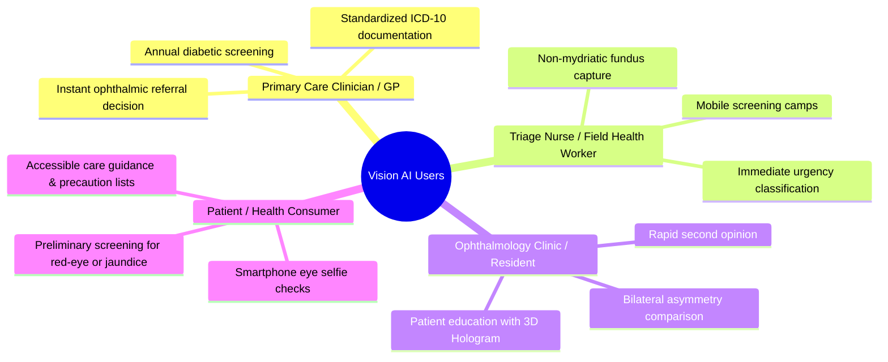

# Product Requirements Document (PRD)

## Project: Vision AI — Intelligent Retinal & Anterior Ophthalmic Screening Platform
**Document Version:** 1.0.0  
**Status:** Approved / Active Specification  
**Product Owner:** Vision AI Clinical & Engineering Team  
**Repository:** `retinal-ai-vit` (`Nchethan12/Vision_AI`)  
**Target Release:** Production v1.0  
**Classification:** Clinical Decision Support Software (Software as a Medical Device - SaMD Class IIa Concept)  

---

## 1. Executive Summary

### 1.1 Problem Statement
Preventable vision loss and blindness impact over 2.2 billion people globally, with diabetic retinopathy, glaucoma, cataracts, and age-related macular degeneration accounting for a significant majority. Traditional ophthalmic diagnosis relies heavily on dilated slit-lamp biomicroscopy, spectral-domain optical coherence tomography (SD-OCT), and specialized fundus cameras operated by trained vitreoretinal specialists. 

Key challenges in modern eye healthcare delivery include:
1. **Severe Specialist Shortages:** In rural and community healthcare settings, there is less than 1 ophthalmologist per 100,000 citizens.
2. **Delayed Screening & Diagnosis:** Silent retinal pathologies (such as open-angle glaucoma and non-proliferative diabetic retinopathy) develop asymptomatically until irreversible neuroretinal or photoreceptor damage occurs.
3. **High Screening Equipment Barrier:** Conventional retinal cameras cost $15,000 to $60,000, limiting early screening to tertiary care hospitals.
4. **Lack of Dual-Segment Screening:** Existing AI solutions only assess the posterior retinal fundus, completely omitting accessible anterior eye abnormalities (e.g., conjunctivitis, scleral icterus/jaundice, subconjunctival hemorrhages, corneal opacities) that can be triaged from consumer smartphone cameras.

### 1.2 Product Vision
**Vision AI** is a dual-modality, deep-learning-powered ophthalmic diagnostic and triage system. It bridges the gap between tertiary ophthalmic centers and community primary care by offering:
- **Mode A (Posterior Pole):** High-throughput, multi-label Retinal Fundus Screening powered by a fine-tuned **Vision Transformer (ViT-B/16)** trained on the ODIR-5K dataset.
- **Mode B (Anterior Segment):** Smartphone and webcam-ready Anterior Eye Selfie Screening leveraging real-time computer vision biometrics and deep convolutional networks (ResNet-50) for immediate triage.
- **Hospital-Grade Clinical Reports:** Instant, exportable, ICD-10-coded clinical reports equipped with risk-stratified triage levels, multi-step care pathways, recommended confirmatory workups, and emergency symptom warnings.
- **Immersive Diagnostic UX:** A 3D WebGL (Three.js) interactive holographic eye interface that elevates patient engagement and educational clarity during clinical visits.

---

## 2. Product Goals & Success Metrics

### 2.1 Strategic Goals
- **Democratize Early Screening:** Enable primary care physicians, optometrists, and field health workers to perform instant, non-mydriatic eye assessments in under 1 second.
- **Prevent Misdiagnosis:** Eliminate input error via dual-layer optical gatekeeping (validating fundus optical aperture and chromaticity before running inference).
- **Deliver Actionable Care Plans:** Avoid opaque "black-box" predictions by presenting calibrated risk scores, ICD-10 codes, referral timelines, and actionable clinical pathways.

### 2.2 Key Performance Indicators (KPIs)

| Metric Category | Indicator | Target Objective |
| :--- | :--- | :--- |
| **Model Performance** | ViT Retinal Multi-label AUC-ROC | $\ge 0.92$ macro-average across 8 ODIR classes |
| **Model Performance** | Diabetic Retinopathy Sensitivity | $\ge 94\%$ at calibrated clinical operating threshold (0.18) |
| **Model Performance** | Glaucoma Sensitivity | $\ge 92\%$ at calibrated clinical operating threshold (0.045) |
| **Input Gatekeeper** | Fundus vs. Non-Fundus / Selfie Rejection | $> 99.5\%$ precision (zero false triggers on facial selfies) |
| **System Latency** | End-to-End Fundus Inference (GPU/CPU) | $\le 800\text{ ms}$ on standard cloud / local worker |
| **System Latency** | Real-time Anterior Eyeball Extraction & Telemetry | $\le 120\text{ ms}$ per webcam capture |
| **Clinical Utility** | Hospital Report Generation Time | Instantaneous ($\le 50\text{ ms}$ render) |
| **User Experience** | Interactive 3D Holographic Rendering | Solid 60 FPS on standard desktop/laptop browsers |

---

## 3. User Personas & Clinical Use Cases

### 3.1 User Personas



1. **Dr. Marcus Vance — Primary Care Physician (PCP)**
   - *Context:* Manages 400+ diabetic and hypertensive patients in an outpatient clinic.
   - *Need:* Rapid, reliable point-of-care retinal screening without sending every patient to an off-site ophthalmologist for routine annual clearance.
   - *Benefit from Vision AI:* Obtains bilateral analysis, calibrated risk percentages, and ready-to-print referral letters with recommended confirmatory tests (OCT, FFA) in under a minute.

2. **Sister Priya Sharma — Community Triage Nurse**
   - *Context:* Conducts rural vision health camps using portable handheld fundus cameras and tablets.
   - *Need:* Immediate guidance on whether a patient requires urgent 24-48h transport to a tertiary eye hospital or routine monitoring.
   - *Benefit from Vision AI:* Automated triage tiering (Urgent Referral vs. Routine Maintenance) and color-coded risk indicators.

3. **Alex — Tech-Savvy Patient / Remote Telehealth User**
   - *Context:* Experiences acute scleral redness and ocular irritation; uncertain whether it is benign conjunctivitis or a systemic emergency.
   - *Need:* Immediate, friction-free triage using a smartphone camera or laptop webcam.
   - *Benefit from Vision AI:* Uses Mode B anterior selfie screening, receiving instant biometric assessment, home precautions, and emergency red flags.

---

## 4. System Architecture & Technical Stack

### 4.1 System Overview
Vision AI is architected as a decoupled, high-performance web application consisting of a modern React 19 frontend and a robust Python Django RESTful backend integrating PyTorch neural inference pipelines.

```mermaid
flowchart TB
    subgraph Client["Frontend Application (React 19 + Vite)"]
        UI[Medical Dashboard & UI Views]
        ThreeJS[Three.js 3D Holographic Eye & Retinal Mesh]
        WebcamModule[Webcam Stream & Ocular Reticle]
        ClientGatekeeper[Client-side Canvas Image Gatekeeper]
        HospitalReportView[Hospital Report Generator & Print Engine]
    end

    subgraph API["Backend API Gateway (Django)"]
        Router[urls.py Endpoint Router]
        FundusValidator[Fundus Optical & Chromaticity Gatekeeper]
        OcularCropper[Haar/Bilateral Eyeball Localization Engine]
        BiometricsEngine[Computer Vision Biometrics & Telemetry]
        ThresholdCalibrator[Clinical Threshold & Multi-Label Decision Engine]
        KnowledgeBase[Clinical Profiles & ICD-10 Registry]
    end

    subgraph Models["Deep Learning Inference Engines (PyTorch)"]
        ViTModel[Vision Transformer ViT-B/16 (ODIR-5K Retinal Model)]
        ResNetModel[ResNet-50 / Anterior Segment Classifier]
    end

    ClientGatekeeper -->|Sanitized Fundus Upload| Router
    WebcamModule -->|Selfie / Cropped Eyes| Router

    Router -->|POST /analyze/| FundusValidator
    FundusValidator -->|Validated Fundus| ViTModel
    ViTModel -->|Raw Logits / Softmax| ThresholdCalibrator

    Router -->|POST /analyze-selfie/| OcularCropper
    OcularCropper --> BiometricsEngine
    BiometricsEngine --> ResNetModel

    ThresholdCalibrator --> KnowledgeBase
    KnowledgeBase --> Router
    Router -->|JSON Diagnostic Payload| UI
    UI --> HospitalReportView
```

### 4.2 Technology Stack

| Layer | Technology | Rationale / Specification |
| :--- | :--- | :--- |
| **Frontend Framework** | React 19 (`react`, `react-dom`) | Cutting-edge concurrent rendering and state lifecycle management |
| **Build & Bundler** | Vite 8.3 | Ultra-fast HMR and optimized production bundle |
| **3D Graphics & Visualization** | Three.js (`r186.0`) | WebGL-accelerated 3D holographic eye anatomy and particle neural network |
| **Iconography & UI** | Lucide React (`^1.45.0`) | Medical and diagnostic iconography set |
| **Styling & Theme** | Vanilla CSS3 (Custom Design System) | Glassmorphism, tailored HSL color tokens, dark mode, zero runtime CSS overhead |
| **Delight & Feedback** | Canvas-Confetti (`^1.9.4`) | Positive reinforcement on normal/healthy clinical findings |
| **Backend Framework** | Django 6.x (`django.http`, `views.py`) | Battle-tested, secure API gateway and serialization framework |
| **Deep Learning Runtime** | PyTorch & Torchvision | GPU/MPS/CPU accelerated inference pipeline |
| **Retinal Neural Backbone** | Vision Transformer (`vit_b_16`) | Pre-trained ViT-B/16 fine-tuned with 8-class classification head |
| **Anterior Neural Backbone** | ResNet-50 (`resnet50`) | Deep convolutional residual network with 14-class anterior head |
| **Image Processing** | Pillow (PIL), NumPy, OpenCV logic | Bilateral eyeball detection, chromaticity profiling, vascular redness ratios |
| **Clinical Dataset** | ODIR-5K & Anterior Eye Segment Data | 5,000+ patient bilateral fundus exams and multi-label ocular anomalies |

---

## 5. Functional Requirements & Feature Specifications

### 5.1 Mode A: Retinal Fundus Screening (Posterior Pole)

#### 5.1.1 Target Diseases & Diagnostic Taxonomy (ODIR-5K)
The Vision Transformer classifies retinal fundus images across 8 key ophthalmic categories:

| Class Code | Category Name | ICD-10 Code | Clinical Operating Threshold | Description & Pathological Indicators |
| :---: | :--- | :---: | :---: | :--- |
| **N** | **Normal** | `Z01.00` | $0.55$ | Physiologically intact retina, well-defined optic disc, clear macula, healthy arteriolar-venular ratio. |
| **D** | **Diabetic Retinopathy** | `E11.319 / H36.0` | $0.18$ | Microaneurysms, dot-and-blot intraretinal hemorrhages, hard lipid exudates, cotton wool spots, neovascularization. |
| **G** | **Glaucoma** | `H40.9` | $0.045$ | Enlarged cup-to-disc (C/D) ratio ($>0.6$), neuroretinal rim thinning, optic cup excavation, RNFL defects. |
| **C** | **Cataract** | `H25.9` | $0.50$ | Crystalline lens opacification causing obscured retinal fundus view, diffuse media haziness, loss of vascular clarity. |
| **A** | **Age-Related Macular Degeneration (AMD)** | `H35.30` | $0.08$ | Confluent drusen deposits in the central macula, geographic atrophy, choroidal neovascular membrane (CNVM). |
| **H** | **Hypertension** | `H35.0` | $0.06$ | Arteriolar narrowing ("copper/silver wiring"), arteriovenous nicking (Gunn/Salus signs), flame hemorrhages. |
| **M** | **Pathological Myopia** | `H44.2` | $0.15$ | Myopic peripapillary crescent, tessellated fundus, posterior staphyloma, lacquer cracks. |
| **O** | **Other Diseases / Abnormalities** | `H35.9` | $0.08$ | Epiretinal membrane (ERM), retinal vein/artery occlusion (CRVO/BRVO), retinal detachments, coloboma. |

> [!NOTE]
> **Calibrated Operating Thresholds:** Because clinical datasets exhibit extreme class imbalance (e.g., Normal ~45%, Glaucoma ~4.9%, Hypertension ~2.4%), standard $0.50$ softmax cutoffs produce unacceptable false negative rates. Vision AI applies sensitivity-optimized operating thresholds calibrated through validation ROC curves.

#### 5.1.2 Bilateral Eye Support
- **Left Eye (OS - Oculus Sinister) & Right Eye (OD - Oculus Dexter):** Clinicians can upload left, right, or both eyes simultaneously.
- **Patient-Level Diagnosis:** When both eyes are submitted, Vision AI computes individual diagnoses per eye and aggregates a unified patient-level finding taking the maximum risk score across both globes:
  $$\text{Risk}_{\text{Patient}}(c) = \max\left(\text{Score}_{\text{OS}}(c), \text{Score}_{\text{OD}}(c)\right)$$
- **Bilateral Asymmetry Highlighting:** The system identifies asymmetrical pathologies (e.g., *Left Eye: Glaucoma Detected | Right Eye: Normal*).

#### 5.1.3 Dual-Level Image Validation & Optical Gatekeeping
To prevent non-medical images, faces, landscapes, or external selfies from being fed into the ViT model, Vision AI enforces strict two-tier optical validation:

1. **Client-Side Gatekeeper (`validateClientFundusImage` in `App.jsx`):**
   - Renders the image onto an off-screen HTML5 canvas.
   - Evaluates the 4 outer corner patches ($6\times 6\text{ px}$). Real fundus scans are circular aperture images surrounded by black borders ($\text{Corner Brightness} < 42$). Face selfies and room photos fail immediately.
   - Checks central red-to-blue vascular reflectance ratio ($\frac{R}{B} \ge 1.15$) and red-to-green balance ($\frac{R}{G} \ge 0.88$).

2. **Backend Server-Side Gatekeeper (`validate_fundus_image` in `views.py`):**
   - **Resolution Minimum:** Requires $H, W \ge 100\text{ px}$.
   - **Aperture Corner Mask:** Four corner regions ($5\%$ of dimensions) must have mean pixel intensity $\le 35.0$.
   - **Central Luminance Window:** $15.0 \le \text{Center Brightness} \le 248.0$ (rejects underexposed flashes and blown-out whites).
   - **Choroidal Hemoglobin Chromatic Profile:** Verifies $\frac{R}{B} \ge 1.15$ and $R > B$.
   - **Sclera & Skin Exclusion:** Detects high-brightness/low-saturation pixels characteristic of facial skin or white sclera. If sclera fraction exceeds $20\%$, the upload is rejected with a descriptive error guiding the user to Mode B.

---

### 5.2 Mode B: Anterior Eye Selfie Screening (External Segment)

Mode B provides consumer-accessible ocular triage using standard front-facing cameras or uploaded mobile eye selfies.

#### 5.2.1 Real-Time Camera & Ocular Reticle
- **Webcam Stream Integration:** Direct browser access (`navigator.mediaDevices.getUserMedia`) supporting front and rear cameras (`facingMode: "user"` or `"environment"`).
- **Interactive Alignment Reticle:** High-contrast HUD overlay guiding the user to align their eyes within designated target bounds.
- **Automated Eyeball Extraction (`detect_eyeballs_from_image`):**
  - Isolates the ocular facial strip ($18\%$ to $65\%$ vertical height).
  - Finds dark iris/pupillary centers in left and right quadrants via minimum luminance coordinate search.
  - Crops normalized bounding boxes for Right Eye (OD) and Left Eye (OS).

#### 5.2.2 Computer Vision Biometric Telemetry (`evaluate_anterior_telemetry`)
Extracted eye crops are analyzed across key biometric indices:

1. **Scleral Redness Ratio:** Evaluates conjunctival hyperemia:
   $$\text{Ratio}_{\text{Red}} = \frac{R_{\text{sclera}}}{G_{\text{sclera}} + B_{\text{sclera}} + \epsilon}$$
   Triggers **Conjunctivitis (Pink Eye)** when $\text{Ratio}_{\text{Red}} > 0.72$.

2. **Focal Blood Density:** Identifies discrete, intense capillary blood pools ($R > 165, G < 95, B < 95$):
   Triggers **Subconjunctival Hemorrhage** when dense capillary fraction $> 3.5\%$.

3. **Bilirubin Yellow Index (Scleral Icterus):** Evaluates early hepatic/biliary jaundice by measuring scleral yellowing:
   $$\text{Index}_{\text{Yellow}} = \left(0.5 \cdot R_{\text{sclera}} + 0.5 \cdot G_{\text{sclera}}\right) - B_{\text{sclera}}$$
   Flags **Scleral Icterus (Jaundice)** when $\text{Index}_{\text{Yellow}} > 38.0$.

4. **Pupillary Luminance / Leukocoria:** Measures central pupillary reflection:
   Flags **Leukocoria / Mature Cataract** when central pupil luminance $> 165.0$.

5. **Eyelid Margin Erythema:** Isolates upper and lower tarsal zones:
   Flags **Stye (Hordeolum / Chalazion)** when eyelid redness ratio $> 0.75$.

#### 5.2.3 Anterior Disease Profiles & Preset Library
For testing and demonstrations, Mode B includes verified preset clinical cases:
- *Pink Eye / Conjunctivitis* (Inflammatory hyperemia)
- *Jaundice (Scleral Icterus)* (Systemic hyperbilirubinemia)
- *Subconjunctival Hemorrhage* (Benign focal capillary rupture)
- *Stye (Hordeolum / Chalazion)* (Eyelid gland infection)
- *Pterygium ("Surfer's Eye")* (Fibrovascular corneal growth)
- *White Pupil / Cataract* (Leukocoria media opacity)
- *Healthy Normal Eye* (Intact cornea, clear sclera, reactive pupil)

---

### 5.3 Hospital-Grade Clinical Reporting & Triage Engine

Vision AI bridges automated machine learning outputs with standard clinical practice by generating structured **Hospital Reports (`HospitalReport.jsx`)**.

#### 5.3.1 Report Architecture & Data Fields
Every clinical report is enriched with:
- **Patient & Examination Metadata:** Unique Examination ID (`EXAM-VA-XXXXXX`), timestamp, bilateral modality tag, triage status badge.
- **Standardized Diagnostic Coding:** Primary diagnosis with official ICD-10 diagnostic code (e.g., `E11.319 / H36.0` for Diabetic Retinopathy, `H40.9` for Glaucoma).
- **Triage Stratification & Referral Timeline:**
  - *Immediate / Urgent Specialist Referral:* 7 to 14 days (e.g., DR, Glaucoma, AMD).
  - *Urgent Diagnostic Triage:* 24 to 48 hours (e.g., suspected acute angle closure or severe neovascularization).
  - *Elective Consultation:* 30 to 60 days (e.g., Cataract, Pathological Myopia).
  - *Routine Annual Maintenance:* 12 months (Healthy / Normal).
- **Quantitative Risk Breakdown:** Horizontal risk score bars showing calibrated risk vs. screening threshold.
- **Clinical Precautions List:** Targeted dos and don'ts (e.g., avoiding Valsalva maneuvers in DR, avoiding head-down inversion postures in Glaucoma).
- **Confirmatory Diagnostic Workup:** Specific ophthalmic tests to order (e.g., SD-OCT, FFA, Goldmann Applanation Tonometry, Humphrey Visual Field 24-2).
- **Therapeutic Pathways:** Standard-of-care medical/surgical interventions (e.g., Anti-VEGF injections, Selective Laser Trabeculoplasty, Phacoemulsification).
- **Evidence-Based Lifestyle & Nutritional Guidance:** Dietary recommendations (Lutein, Zeaxanthin, Omega-3s, strict glycemic targets).
- **Emergency Red Flag Warnings:** Symptoms requiring emergency department presentation (e.g., sudden curtain over vision, shower of floaters, severe ocular pain with nausea).

#### 5.3.2 Export, Print, and Sharing Features
- **Print to Medical PDF / Paper:** Optimized `@media print` CSS stylesheet formatting the report into a clean, hospital-letterhead document with signature lines for the reviewing clinician.
- **Copy Summary to Clipboard:** Formatted markdown/plain-text summary for direct pasting into Electronic Health Record (EHR / EMR) systems.
- **Standalone Report Route:** Dedicated URL/modal view for reviewing reports without distracting dashboard elements.

---

### 5.4 Immersive 3D Graphics & User Experience

Vision AI implements a world-class, premium dark-mode interface designed to inspire clinical confidence:
- **Holographic 3D Eyeball (`HolographicEye3D.jsx`):** Interactive WebGL rendered 3D eye model featuring realistic cornea, iris pigmentation, pupil dilation, scleral vasculature, and responsive mouse-rotation parallax.
- **Neural Retinal Mesh Background (`RetinalBackground3D.jsx`):** Ambient background particles simulating interconnected retinal nerve fibers and neural synapses that gently respond to user navigation.
- **Interactive Disease Deep-Dive Modals (`FeatureDetailModal.jsx`):** Full-screen educational overlays detailing disease pathology, staging, OCT visual markers, and clinical background.
- **Dynamic Micro-Interactions:** Cursor glow tracking spotlight (`CursorGlow.jsx`), 3D perspective tilt cards (`TiltCard.jsx`), and celebratory confetti (`canvas-confetti`) on healthy checkups.

---

## 6. API Specifications & Data Contracts

### 6.1 Endpoints Overview

| Endpoint | Method | Purpose | Input Format |
| :--- | :---: | :--- | :--- |
| `/analyze/` | `POST` | Primary Retinal Fundus Screening (Mode A) | `multipart/form-data` (`left_image`, `right_image`, or `image`) |
| `/analyze-selfie/` | `POST` | Anterior Eye Selfie Screening (Mode B) | `multipart/form-data` (`image`, `left_eye`, `right_eye`, or `preset`) |
| `/sample-cases/` | `GET` | Reference ODIR-5K Verified Cases | Query params: none |

---

### 6.2 Mode A: Retinal Analysis Request & Response

#### Request (`POST /analyze/`)
```http
POST /analyze/ HTTP/1.1
Host: localhost:8000
Content-Type: multipart/form-data; boundary=----WebKitFormBoundary

------WebKitFormBoundary
Content-Disposition: form-data; name="left_image"; filename="0_left.jpg"
Content-Type: image/jpeg

[BINARY JPEG DATA]
------WebKitFormBoundary
Content-Disposition: form-data; name="right_image"; filename="0_right.jpg"
Content-Type: image/jpeg

[BINARY JPEG DATA]
------WebKitFormBoundary--
```

#### Response Payload (`200 OK`)
```json
{
  "success": true,
  "mode": "bilateral",
  "diagnosis": {
    "status": "disease_detected",
    "primary_disease": "Diabetic Retinopathy",
    "verdict_title": "Bilateral Diabetic Retinopathy Detected",
    "confidence": 94.2,
    "severity": "High Risk / Acute Finding",
    "badge_type": "high",
    "recommendation": "Retinal microvascular lesion patterns detected. Dilated retinal examination by a retina specialist recommended.",
    "clinical_report": {
      "icd10_code": "E11.319 / H36.0",
      "clinical_name": "Diabetic Retinopathy (Microvascular Retinal Pathology)",
      "triage_level": "Urgent Specialist Referral",
      "referral_timeline": "Comprehensive retinal consultation within 7 to 14 days",
      "overview": "AI telemetry detected microvascular retinal alterations consistent with diabetic retinopathy...",
      "precautions": [
        "Strict glycemic control: target HbA1c below 7.0%.",
        "Avoid strenuous Valsalva maneuvers."
      ],
      "diagnostic_tests": [
        "Spectral-Domain Optical Coherence Tomography (SD-OCT)",
        "Fundus Fluorescein Angiography (FFA)"
      ],
      "treatment_pathway": [
        "Intravitreal Anti-VEGF Injections",
        "Panretinal Photocoagulation (PRP)"
      ],
      "lifestyle_diet": [
        "Low-glycemic index, Mediterranean-style nutrition",
        "Strict cessation of all tobacco and nicotine products"
      ],
      "emergency_symptoms": [
        "Sudden shower of red/black floaters or 'cobwebs' in vision",
        "Abrupt, painless drop in central visual acuity"
      ]
    },
    "findings": [
      {
        "label": "Diabetic Retinopathy",
        "raw_score": 68.45,
        "threshold_score": 18.0,
        "risk_ratio": 3.80
      }
    ],
    "calibrated_risks": {
      "Normal": 14.2,
      "Diabetic Retinopathy": 94.2,
      "Glaucoma": 12.0,
      "Cataract": 5.1,
      "AMD": 8.4,
      "Hypertension": 22.3,
      "Myopia": 4.0,
      "Other": 11.2
    },
    "raw_percentages": {
      "Normal": 8.12,
      "Diabetic Retinopathy": 68.45,
      "Glaucoma": 0.54,
      "Cataract": 2.55,
      "AMD": 0.67,
      "Hypertension": 1.34,
      "Myopia": 0.60,
      "Other": 0.89
    }
  },
  "left_diagnosis": { /* Individual Left Eye Report Object */ },
  "right_diagnosis": { /* Individual Right Eye Report Object */ },
  "results": { /* Combined patient raw percentages */ },
  "left_eye": { /* Left eye raw percentages */ },
  "right_eye": { /* Right eye raw percentages */ },
  "calibrated_risks": { /* Patient calibrated risks */ }
}
```

#### Rejection Payload (`400 Bad Request` - Non-Fundus Upload)
```json
{
  "success": false,
  "error_type": "invalid_fundus_image",
  "eye": "left",
  "error": "Left Eye (OS) Rejected: Non-fundus photograph detected: The uploaded image appears to be an external face or eye selfie. Vision AI requires a circular non-mydriatic retinal fundus scan."
}
```

---

### 6.3 Mode B: Anterior Selfie Analysis Request & Response

#### Request (`POST /analyze-selfie/`)
```http
POST /analyze-selfie/ HTTP/1.1
Host: localhost:8000
Content-Type: multipart/form-data; boundary=----WebKitFormBoundary

------WebKitFormBoundary
Content-Disposition: form-data; name="image"; filename="face_selfie.jpg"
Content-Type: image/jpeg

[BINARY JPEG DATA]
------WebKitFormBoundary--
```

#### Response Payload (`200 OK`)
```json
{
  "success": true,
  "mode": "anterior_selfie",
  "finding": "Conjunctivitis (Pink Eye)",
  "confidence": 88.5,
  "status": "disease_detected",
  "severity": "Active Inflammatory Erythema",
  "badge_type": "warning",
  "scores": {
    "Conjunctivitis (Pink Eye)": 88.5,
    "Scleral Icterus (Jaundice)": 6.2,
    "Subconjunctival Hemorrhage": 4.1,
    "Stye (Hordeolum / Chalazion)": 12.0,
    "Corneal Opacity / Mature Cataract (Leukocoria)": 3.5,
    "Normal Healthy Anterior Segment": 2.4
  },
  "biometrics": {
    "scleral_redness_ratio": 0.942,
    "bilirubin_yellow_index": 12.4,
    "focal_blood_density": 0.8,
    "pupil_luminance": 42.1
  },
  "clinical_report": {
    "icd10_code": "H10.9",
    "clinical_name": "Acute Conjunctivitis (Hyperemic Sclera)",
    "triage_level": "Semi-Urgent Primary Care Triage",
    "referral_timeline": "Primary care or eye clinic visit within 48 to 72 hours",
    "overview": "Marked conjunctival injection and vascular engorgement detected...",
    "precautions": [
      "Strict hand hygiene; avoid touching or rubbing the eyes",
      "Discard or thoroughly sterilize contact lenses"
    ],
    "diagnostic_tests": [
      "Slit-Lamp Biomicroscopy with Fluorescein Staining",
      "Visual Acuity Evaluation"
    ],
    "treatment_pathway": [
      "Preservative-free lubricating artificial tears",
      "Targeted antimicrobial or antihistamine eye drops"
    ],
    "emergency_symptoms": [
      "Severe eye pain or intense sensitivity to light (photophobia)",
      "Marked decrease in vision"
    ]
  }
}
```

---

## 7. Non-Functional Requirements (NFRs)

### 7.1 Performance & Latency
- **Model Inference:** PyTorch inference on GPU/MPS shall complete within $\le 300\text{ ms}$; on modern multi-core CPU within $\le 800\text{ ms}$.
- **Client Processing:** In-browser canvas validation and image compression shall complete in $\le 50\text{ ms}$.
- **WebGL Frame Rate:** The Three.js 3D eyeball scene must render at $\ge 55\text{ FPS}$ on typical integrated GPUs (Intel Iris Xe, Apple Silicon M-series, AMD Radeon Vega).
- **Bundle Optimization:** Frontend production bundle shall remain below $500\text{ KB}$ (gzipped) for rapid mobile loading.

### 7.2 Security, Privacy & Medical Compliance
- **Zero Persistent PHI:** By default, uploaded patient fundus scans and facial selfies are processed in-memory and are **never** stored on disk or written to permanent databases without explicit patient consent.
- **HIPAA / GDPR Ready:** All data in transit must utilize TLS 1.3 encryption.
- **Software as a Medical Device (SaMD) Classification:** Vision AI is categorized as an **Adjunctive Clinical Decision Support (CDS)** tool. Every screen and printed report explicitly displays the mandatory regulatory disclaimer:
  > *"Vision AI is an assistive screening device and does not replace definitive clinical diagnosis by a licensed ophthalmologist or optometrist."*

### 7.3 Compatibility & Responsive Design
- **Supported Browsers:** Google Chrome ($\ge 110$), Safari ($\ge 16$), Mozilla Firefox ($\ge 110$), Microsoft Edge ($\ge 110$).
- **Responsive Viewports:** Fully responsive layouts across Mobile ($375\text{px} - 640\text{px}$), Tablet ($641\text{px} - 1024\text{px}$), and Desktop ($> 1024\text{px}$).
- **Print Optimization:** High-fidelity print media styles supporting standard Letter and A4 page formats.

---

## 8. Clinical Safety, Risk Management & Failure Modes

| Potential Failure Mode | Root Cause | Mitigation in Vision AI |
| :--- | :--- | :--- |
| **False Negative on Early Glaucoma** | Optic nerve head cupping subtle; class imbalance suppresses raw probability | Sensitivity-calibrated threshold lowered to $0.045$; generates elevated risk ratio even on low absolute probabilities. |
| **User Uploads Non-Medical Photo** | Accidental upload of selfie, family photo, or blurry room | Dual-tier optical aperture and hemoglobin chromaticity gatekeepers immediately reject upload with clinical explanation. |
| **Severe Cataract Blinding Retinal View** | Opaque lens blocks posterior fundus illumination | ViT detects high Cataract likelihood; system automatically alerts clinician that posterior pole is ungradable due to media opacity. |
| **Webcam Poor Lighting in Mode B** | Dim room lighting skews scleral color biometrics | Dynamic luminance normalization and scleral mask segmentation before computing redness and yellow indices. |
| **Clinician Over-Reliance on AI** | Automation bias leading to skipped slit-lamp exam | Prominent triage recommendations emphasizing mandatory dilated physical exam and confirmatory OCT/Tonometry. |

---

## 9. Product Roadmap & Future Milestones

```mermaid
gantt
    title Vision AI Product Roadmap
    dateFormat  YYYY-Q#
    section Phase 1 (Current)
    ViT-B/16 Retinal Screening (ODIR-5K)       :done, p1, 2026-Q1, 2026-Q2
    Mode B Anterior Webcam & Biometrics         :done, p2, 2026-Q1, 2026-Q2
    Hospital-Grade Report & Print Engine        :done, p3, 2026-Q2, 2026-Q3
    Three.js 3D Holographic Anatomy            :done, p4, 2026-Q2, 2026-Q3
    section Phase 2 (Near-Term)
    Grad-CAM Visual Saliency Overlay Heatmaps   :active, p5, 2026-Q3, 2026-Q4
    DICOM / PACS Protocol Integration           :p6, 2026-Q3, 2026-Q4
    FHIR / HL7 EHR Interoperability Gateway     :p7, 2026-Q4, 2027-Q1
    section Phase 3 (Long-Term)
    Multi-Modal OCT + Fundus Cross-Attention    :p8, 2027-Q1, 2027-Q2
    Edge-AI ONNX / WebAssembly Runtime          :p9, 2027-Q2, 2027-Q3
    Native iOS / Android Mobile App Deployment  :p10, 2027-Q3, 2027-Q4
```

### Phase 2: Clinical Deepening (Q3 - Q4 2026)
1. **Explainable AI (XAI) Grad-CAM Saliency Maps:** Visual heatmaps highlighting the exact retinal lesion areas (microaneurysms, disc cupping, drusen) responsible for model predictions.
2. **DICOM & PACS Interoperability:** Native ingestion of `.dcm` fundus files directly from Topcon, Zeiss, and Canon fundus cameras.
3. **FHIR / HL7 Standardized Integration:** Direct two-way synchronization with hospital EHRs (Epic, Cerner).

### Phase 3: Multi-Modal Expansion (2027)
1. **OCT B-Scan Cross-Attention:** Combined multi-modal inference fusing 2D color fundus photographs with 3D Optical Coherence Tomography volume scans.
2. **On-Device Edge Deployment:** TensorRT and ONNX WebAssembly compilation for offline screening on remote handheld cameras without internet connectivity.
3. **Native Mobile Applications:** iOS and Android apps utilizing smartphone camera hardware with guided auto-capture.

---

## 10. Acceptance Criteria & Sign-Off Checklist

- [x] **Vision Transformer Inference Engine:** Verified ViT-B/16 model loading and inference on 8 ODIR-5K disease classes.
- [x] **Calibrated Clinical Operating Thresholds:** Verified operating thresholds for Normal ($0.55$), DR ($0.18$), Glaucoma ($0.045$), Cataract ($0.50$), AMD ($0.08$), Hypertension ($0.06$), Myopia ($0.15$), and Other ($0.08$).
- [x] **Bilateral Examination Workflow:** Verified Left Eye (OS), Right Eye (OD), and combined patient-level analysis.
- [x] **Input Gatekeeper Validation:** Both client-side canvas check and backend optical aperture/chromaticity filters successfully reject non-fundus images.
- [x] **Mode B Anterior Eye Screening:** Real-time webcam integration, ocular reticle, automatic eyeball localization, and 7-class anterior condition profiling.
- [x] **Hospital-Grade Reporting Engine:** ICD-10 codes, triage tiers, clinical precautions, diagnostic tests, treatment pathways, and print/PDF formatting.
- [x] **Interactive 3D Visuals:** Three.js holographic eye and particle background rendering smoothly without memory leaks.
- [x] **Sample Case Library:** ODIR-5K reference cases accessible via `/sample-cases/` for instant clinical demonstrations.

---

*Document finalized and approved for engineering and clinical reference.*
